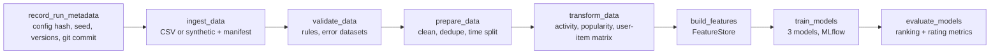
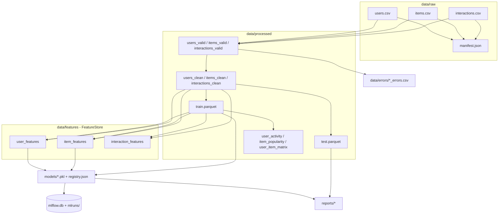

# Pipeline Architecture

## Stage flow

Both runners execute this same chain. The stage list is defined once in
`src/orchestration/stages.py`:

- `python -m dags.recommendation_pipeline` runs it with the plain-Python runner
  (`src/orchestration/workflow.py`, logs to `reports/run_log.txt`).
- `dags/recommendation_dag.py` runs it as an Airflow DAG (Docker, LocalExecutor, PostgreSQL).

## Data flow and artifacts

## Models

| Model | Inputs | Role |
|---|---|---|
| `popularity_baseline` | item features (positive count, average rating) | baseline, also the fallback for cold users |
| `genre_content_recommender` | user genre affinity and item genre flags (FeatureStore), item popularity | content-based hybrid |
| `biased_matrix_factorization` | training ratings (SGD) | personalised collaborative filtering |

## Guarantees

- **No leakage:** the split is one global time cutoff. Every feature, popularity count and model
  is fitted on the training split only.
- **Reproducibility:** a single seed drives synthetic data, model initialisation and SGD order.
  `reports/run_metadata.json` records the config hash and package versions for each run.
- **Validation:** the future-timestamp rule uses `reference_date` from `configs/pipeline.json`,
  not the wall clock.
